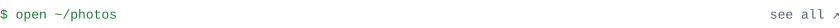
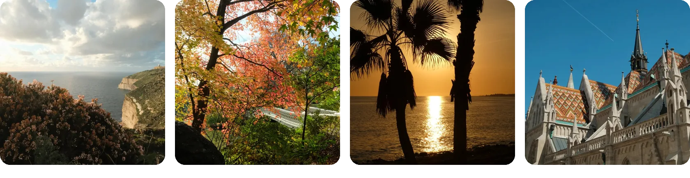
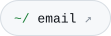

<!-- The card, link chips and photos are generated. Edit the text in scripts/build_readme.py, then run:
       python3 scripts/build_readme.py
     Photos rotate daily via .github/workflows/rotate-photos.yml (pool: assets/photos/pool). -->

<picture>
  <source media="(max-width: 600px) and (prefers-color-scheme: dark)" srcset="assets/card/phone-dark.svg">
  <source media="(max-width: 600px)" srcset="assets/card/phone-light.svg">
  <source media="(prefers-color-scheme: dark)" srcset="assets/card/desktop-dark.svg">
  
</picture>

<a href="https://vsco.co/arjun-sehgal/gallery">
  <picture>
    <source media="(max-width: 600px) and (prefers-color-scheme: dark)" srcset="assets/photos/header-phone-dark.svg">
    <source media="(max-width: 600px)" srcset="assets/photos/header-phone-light.svg">
    <source media="(prefers-color-scheme: dark)" srcset="assets/photos/header-desktop-dark.svg">
    
  </picture>
</a>
<a href="https://vsco.co/arjun-sehgal/gallery">
  <picture>
    <source media="(max-width: 600px)" srcset="assets/photos/grid.webp">
    
  </picture>
</a>

  <a href="https://www.instagram.com/_arjunsehgal_/"><picture><source media="(prefers-color-scheme: dark)" srcset="assets/links/instagram-dark.svg"></picture></a>
  <a href="https://www.linkedin.com/in/sehgal-arjun/"><picture><source media="(prefers-color-scheme: dark)" srcset="assets/links/linkedin-dark.svg"></picture></a>
  <a href="mailto:a5sehgal@uwaterloo.ca"><picture><source media="(prefers-color-scheme: dark)" srcset="assets/links/email-dark.svg"></picture></a>
  <a href="https://www.arjunsehgal.co.uk"><picture><source media="(prefers-color-scheme: dark)" srcset="assets/links/website-dark.svg"></picture></a>
  <a href="https://vsco.co/arjun-sehgal/gallery"><picture><source media="(prefers-color-scheme: dark)" srcset="assets/links/photos-dark.svg"></picture></a>

Thanks for visiting my profile! Feel free to explore my repositories and reach out if you have any questions or collaboration ideas :D

